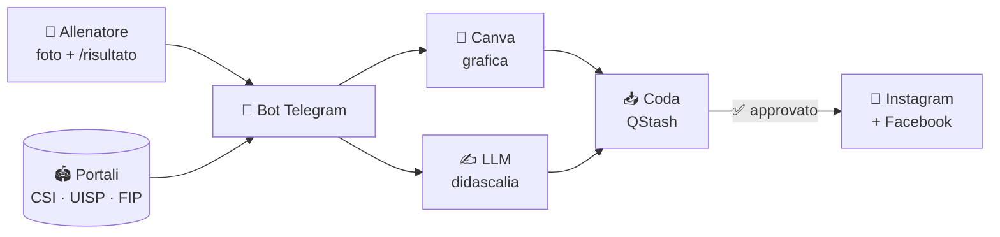

<div align="center">

# 🏆 club-social-bot

**Il bot Telegram che fa i social di una società sportiva.**<br>
Foto + risultato nel gruppo → grafica Canva → post su Instagram e Facebook.


</div>

---

> 🇬🇧 **In English**
>
> Telegram bot that runs the social media of an amateur sports club.
>
> Coaches send a photo and a score in a Telegram group.
> The bot pulls fixtures from league portals, builds the graphic in Canva,
> writes the caption with an LLM and publishes to Instagram and Facebook.
>
> Showcase repo: code and comments are in Italian.

---

## ✨ Cosa fa

| | Funzione | Come |
|---|---|---|
| 📸 | **Risultati** | Foto + `/risultato` nel gruppo, il bot propone le partite dai portali e chiede il punteggio |
| 🎨 | **Grafiche** | Riempie i template Canva con squadre, punteggio, loghi e foto ritagliata |
| ✍️ | **Didascalie** | Scritte da un LLM partendo da esempi di post veri |
| 📤 | **Pubblicazione** | Coda unica verso Instagram e Facebook, con approvazione ✅ nel gruppo |
| 🗓️ | **Carosello settimanale** | Tutti i risultati della settimana, chiede quelli che mancano |
| 📰 | **Notizie** | News del CSI Milano portate nel gruppo |
| 📊 | **Statistiche** | Report mensile e trimestrale: crescita e "cosa tira" |
| 💌 | **Newsletter** | Mail del venerdì preparata in automatico |

## 🔄 Come funziona



## 🧱 Stack

| Pezzo | Tecnologia |
|---|---|
| Runtime | TypeScript su Vercel Functions + Cron |
| Dati e code | Upstash Redis e QStash |
| Grafiche | Canva Connect API |
| Social | Meta Graph API |
| Testi | Groq (LLM) |
| Mail | Brevo |
| Bot | Bot API Telegram via `fetch`, senza framework |

## 📁 Struttura

```text
api/        handler Vercel: webhook Telegram, cron, login Canva e Instagram
lib/        logica del bot
  ├─ pipeline.ts     dalla foto al post
  ├─ carosello.ts    risultati della settimana
  ├─ bozza.ts        didascalie
  ├─ fonti/          portali CSI, UISP, FIP
  └─ instagram.ts    pubblicazione
scripts/    procedura di release
docs/       manuale tecnico completo
```

## 🚀 Release disciplinate

Ogni modifica passa da `npm run release`:

1. controlla la voce nel registro
2. typecheck
3. deploy su Vercel
4. verifica che le funzioni partano
5. commit, tag `vX.Y.Z` e push

I deploy diretti sono bloccati.

## 📌 Stato

Questo è un repo **vetrina**: lo snapshot di un bot in produzione.

La società nel codice si chiama **SS Cormano**, nome di fantasia.
Nomi, ID e template sono stati sostituiti.

Per farlo girare servono account propri
(Telegram, Canva, Meta, Upstash, Groq, Brevo) e template Canva propri.
Parti da `.env.example` e da `docs/manuale.md`.

🙋 Vuoi usarlo per la tua società? Apri una issue.

## 📄 Licenza

[MIT](LICENSE)
